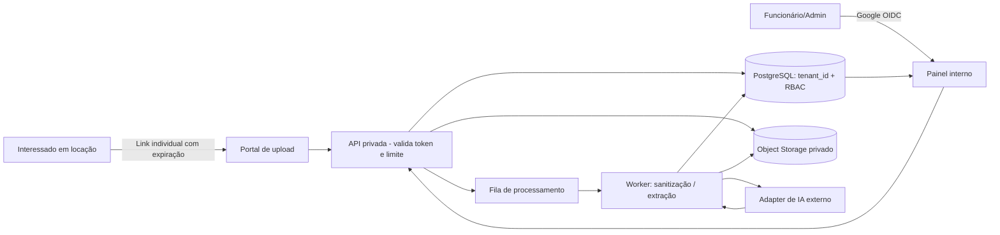

# Arquitetura de referência — Modernize IA

**Estado:** projeto técnico hipotético, não infraestrutura implantada. Alinha P1 §2.4: stack, cloud, escalabilidade, redundância, metodologia e LGPD. Escolha D-025: APIs de IA inicialmente, camada de abstração para provedores, PostgreSQL, fila assíncrona e multi-tenant.

## 1. Contexto e serviços

**Proposta de stack, sujeita à prova de conceito:** frontend TypeScript web, backend Node.js/TypeScript com API protegida; PostgreSQL gerenciado; armazenamento privado de arquivos; fila e worker com retentativas controladas; Google OpenID Connect; serviço de IA externo via adapter (selecionar e precificar no spike). Um provedor possível de banco/auth/storage é Supabase, a validar políticas e restrições de acesso; serviços de execução separados conforme volume.

**Hospedagem:** slides estáticos no **GitHub Pages**; aplicação real do MVP em hospedagem com backend privado (ex.: Cloud Run/serviços gerenciados), **não** apenas GitHub Pages. GitHub Pages não pode guardar credenciais API. A demo acadêmica pode ser inteiramente local e sintética.

## 2. Processo e limites de confiança

1. Colaborador faz login com Google → API valida token OIDC, verifica identidade estável, vínculo ativo e tenant_id, role Admin/Funcionário.
2. Usuário cria solicitação; backend emite identificador e token aleatório com expiração, revogação, escopo **somente de envio daquela solicitação**, limites de upload e anti-abuso.
3. Link de upload sem login **não prova identidade do interessado**; portal informa finalidade e tratamento, coleta arquivos estritamente necessários e os envia ao storage por URL de upload curta e limitada, se adotada.
4. Arquivo validado por assinatura/tipo/tamanho, malware e uso; estado vira processamento; worker controlado lê arquivo privado, extrai informação, chama adapter IA, devolve JSON tipado e sinais de confiança/pendências.
5. IA **nunca define aprovação/recusa de locação**; pessoa designada confere original, corrige campos, pede complementos e registra conclusão.
6. Logs auditáveis registram operações com identificadores (não documentos brutos, tokens ou CPF em texto aberto). Todos os acessos aplicam policy tenant + RBAC no servidor; usar RLS no banco como defesa em profundidade, após testes.

## 3. Modelo mínimo de dados — esquema conceitual

- `tenants(id, nome, ativo, configuracao)`
- `users(id, google_sub, email, nome)`
- `memberships(user_id, tenant_id, role, status)` — vínculo e perfil por imobiliária; **não autorizar por e-mail do Gmail isoladamente**.
- `applications(id, tenant_id, assignee_id, status, created_at, updated_at, interested_alias)`
- `upload_links(id, application_id, tenant_id, token_hash, expires_at, revoked_at, max_uses)`
- `documents(id, tenant_id, application_id, storage_key, type, metadata, state, created_at)`
- `extractions(id, tenant_id, document_id, provider, model_version, fields_json, warnings_json, review_state)`
- `audit_events(id, tenant_id, actor_id, application_id, event_type, timestamp, safe_metadata)`

**Regras:** referência ao tenant em tabelas e na chave do storage; índices por tenant; limites/paginação; timestamps UTC; audit sem conteúdo de documentos; criptografia em repouso e trânsito; segredos nunca em frontend.

## 4. Recursos operacionais / disponibilidade

- **Filas:** idempotência por documento, retentativa limitada, backoff, dead-letter, status “falhou”, reprocessamento explícito e limite de concorrência por tenant.
- **Isolamento:** testes automatizados tenant A não lê/escreve objetos B em cada rota/query/armazenamento; proteção contra IDOR, links compartilhados, vazamentos em logs e caches.
- **Arquivos:** limites iniciais sugeridos para teste com imagens/PDFs; definir MIME, até 10 MB por arquivo como **hipótese técnica**, antivírus e política de retenção antes de produção.
- **Observabilidade:** métricas de filas, erros por etapa, tempo processamento, custos por documento e falhas por provedor, sem PII.
- **Resiliência:** backup automático do banco + teste de restauração, inventário de documentos e rotina de recuperação; RPO/RTO a contratar. Exportação dos dados em formato padrão reduz lock-in.
- **Degradação:** se IA indisponível, aceitar documento e permitir checklist/revisão **manual**, sem fingir extração.
- **Escalabilidade:** aumentar workers independentes de app, limites/quotas por tenant, medir latência p95 e custos em piloto.

## 5. Cloud e custos — status de orçamento

- [Supabase preços públicos](https://supabase.com/pricing): Pro a partir de **US$ 25/mês**, sujeito a compute, armazenamento/uso, câmbio, tributos; **não representa cotação fechada**.
- [Cloud Run cobrança por uso](https://cloud.google.com/run): instâncias executadas conforme CPU/memória e tráfego; free tier depende de configuração e região.
- [APIs de IA](https://developers.openai.com/api/docs/pricing): cobrança depende de modelo, tokens, arquivos/imagens, retries e política de dados; **testar lote de documentos FICTÍCIOS** para estimar custo real por cadastro.
- No financeiro, **R$ 1.000/mês fixos e R$ 40/cliente/mês variáveis** são placeholders acadêmicos, **não derivados dessas tabelas USD**. Diferença precisa ficar visível até orçamento detalhado.

## 6. Método de engenharia e segurança

Iterações quinzenais hipotéticas, backlog, revisão por PR, lint, testes unitários/integração/segurança, pipeline CI, staging separado, secrets manager, build reproduzível e releases versionadas. Do not deploy real tenant data to frontend static demo. Testes de aceite: fluxo feliz + upload inválido + expiração/revogação + falha IA + revisão humana + ausência de acesso cruzado.

### Arquitetura da DEMO acadêmica

HTML/CSS/JS estático derivado estruturalmente do GranaXP, **somente dados sintéticos em memória/localStorage** e motor de respostas determinísticas. Não possui autenticação Google de produção, backend, banco real nem processamento de documentos verdadeiros. A demo expõe uma jornada e prova a UX, não garante arquitetura SaaS operando.
